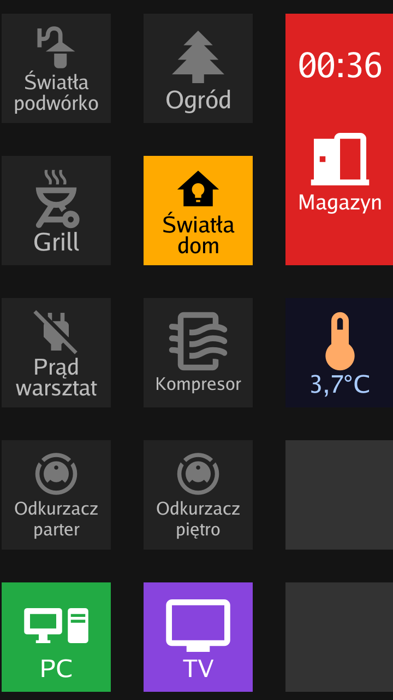

# Ulanzi_D200_esphome_host

ESPHome running **on the Ulanzi D200 itself**: no ESP32, no soldering. The D200's Rockchip RK3308 runs
open firmware (mainline Linux, [d200-buildroot](https://github.com/riptidewave93/d200-buildroot)), joins your WiFi
through a USB dongle, and runs an ESPHome [`host`](https://esphome.io/components/host/) build (aarch64 Linux)
that Home Assistant adopts like any other ESPHome device.

This is a fork of [mapero/esphome-ulanzi-d200](https://github.com/mapero/esphome-ulanzi-d200). It keeps its
`ulanzi_d200` component and `ulanzi-control` daemon (with fixes for ESPHome 2026.10 and the mainline kernel), and adds
the firmware and the host build. Upstream's ESP32 variant is kept: see [docs/component.md](docs/component.md).



## Status

Works on the author's D200: ESPHome 2026.10.2 with the encrypted API, OTA updates, Home Assistant
actions, a main page of keys and a weather page. The daemon uses about 17.5 MB RSS and 2% of a core. Open issues and measurements:
[docs/development-notes.md](docs/development-notes.md).

## Hardware

- **Ulanzi D200** (RK3308H1/H3).
- **USB-C hub with a USB-C PD input**, and a USB-C charger for it. Tested: Hiearcool UCN3273.
- **MT7601U USB WiFi dongle** (`148f:7601`). An Ethernet adapter in the hub works too (tested: AX88179).

The D200 has a single USB-C port, which is also its power input. This firmware turns it into a USB host port,
and the D200 can't power a dongle from it. The hub fixes both: the charger on its PD input powers the hub, the dongle and,
through the hub's upstream cable, the D200. Plug in charger → hub → D200, with the dongle in a USB-A port of the hub.

Not every dongle works behind the RK3308's DWC2 host controller: the Atheros AR9271 (`ath9k_htc`) loads its
firmware and then fails with `Failed to read SREV register`. The MT7601U runs at −41 dBm, 72 Mb/s.

## Architecture

```
                         WiFi (MT7601U) or Ethernet
  Home Assistant  ◀──────────────────────────────────▶  ESPHome host build          /data/esphome/d200
  (ESPHome integration)    API :6053, OTA :8082           + ulanzi_d200 component
                                                                │ NDJSON, 1.5 Mbaud "UART"
                                                                ▼
                                       /run/d200-esp ⇄ socat pty pair ⇄ /run/d200-daemon
                                                                                │
                                                                                ▼
                                                            ulanzi-control (Go)  /data/ulanzi-control
                                                              ├──▶ /dev/fb0            720x1280 display
                                                              ├◀── /dev/input/event0   14 keys
                                                              └──▶ /sys/class/backlight
```

`S70esphome` (in the firmware) starts socat, the daemon and ESPHome. ESPHome owns the logic and the Home Assistant
connection; the daemon draws the keys and reports presses. They speak the same NDJSON protocol as upstream's ESP32
and D200 over a real UART.

## Quick start

1. **Build and flash the firmware**: [buildroot/README.md](buildroot/README.md).
2. **First setup over USB**: on first boot the D200 is a USB device with SSH over USB. Give it your WiFi
   credentials and switch the port to host mode as described in [buildroot/README.md](buildroot/README.md). Then
   power it through the hub, with the dongle in the hub.
3. **Build and install ESPHome** (Linux or WSL, using the toolchain from the firmware build):
   ```sh
   examples/host/build.sh                 # first time: copy the binaries by hand,
                                          # see examples/host/README.md
   DEVICE=<D200 IP> examples/host/deploy.sh   # afterwards: compile + OTA
   ```
   The first build writes a random API key to `examples/host/secrets.yaml` (git-ignored).
4. **Add it to Home Assistant**: Settings → Devices & services → ESPHome. The device is discovered over mDNS, or
   add it by IP. Enter the `api_encryption_key` from `examples/host/secrets.yaml`. Then, on the device's
   integration entry, Configure → enable **"Allow the device to perform Home Assistant actions"**, or the keys
   can show states but not switch anything.

## Changing the UI

Edit [`examples/host/d200.yaml`](examples/host/d200.yaml): the Home Assistant entities and labels are the
`substitutions:` at the top, and each key is a `section` (concepts: [docs/component.md](docs/component.md), every
option: [docs/configuration.md](docs/configuration.md)). Then run `DEVICE=<D200 IP> examples/host/deploy.sh`: it
compiles and uploads by OTA, and ESPHome restarts with the new layout a few seconds later. UI changes never need a
firmware or daemon update.

## Repository layout

```
buildroot/              firmware: patches for d200-buildroot, build.sh, README (GPL-2.0-or-later)
components/ulanzi_d200/ ESPHome component (both variants)
daemon/                 ulanzi-control, the Go daemon on the D200 (display, keys, backlight)
examples/host/          host variant: d200.yaml, build.sh, deploy.sh
examples/*.yaml         ESP32 variant examples (upstream)
docs/                   component.md (upstream README), configuration.md, development-notes.md,
                        d200-preparation.md (ESP32 variant)
firmware/, install.*    ESP32 variant on the stock firmware: patched boot image, daemon installer (upstream)
```

## Credits and licences

- [mapero/esphome-ulanzi-d200](https://github.com/mapero/esphome-ulanzi-d200) by Jochen Scheib: the
  `ulanzi_d200` component, the `ulanzi-control` daemon and most of `docs/`. MIT.
- [riptidewave93/d200-buildroot](https://github.com/riptidewave93/d200-buildroot): open firmware for the D200,
  which `buildroot/` patches. GPL-2.0-or-later.
- [debauer/D200-Unchained](https://github.com/debauer/D200-Unchained): D200 hardware notes.
- [ESPHome](https://esphome.io): the host platform. MIT (Python code) and GPL-3.0 (C++ runtime).

Everything in this repository except `buildroot/` is under the MIT licence in [LICENSE](LICENSE).
`buildroot/` is GPL-2.0-or-later, like the Buildroot tree it patches.
