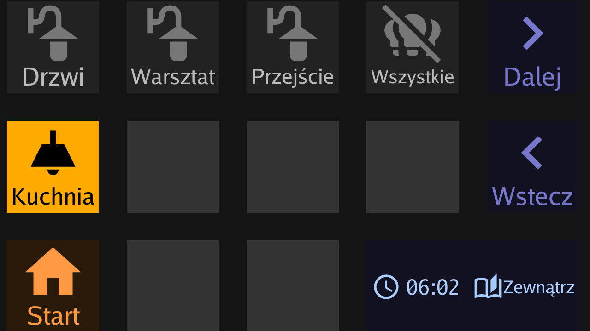
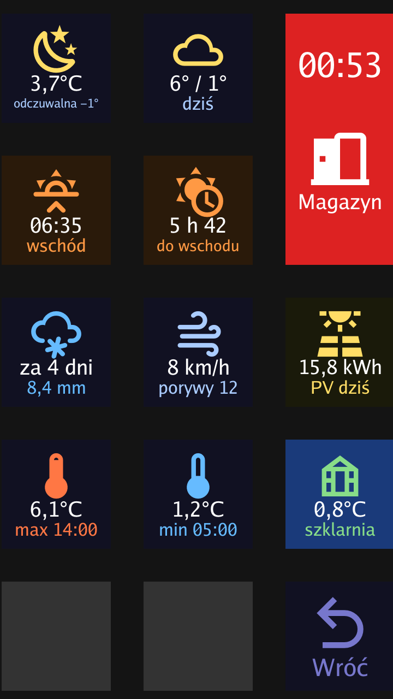

# ESPHome on the D200 itself (host platform, aarch64)

The ESPHome config and build scripts for running ESPHome on the D200's RK3308.
The device needs the firmware from [`../../buildroot/`](../../buildroot/README.md), which runs `S70esphome`:

```
Home Assistant ──API 6053──▶ /data/esphome/d200 ──/run/d200-esp ⇄ socat ⇄ /run/d200-daemon──▶ /data/ulanzi-control/ulanzi-control
                             (ESPHome host + ulanzi_d200)                                       (draws /dev/fb0, reads /dev/input/event0)
```

| File | What |
|---|---|
| `d200.yaml` | ESPHome config. HA entity IDs and key labels are the `substitutions:` at the top |
| `d200-toggle.yaml` | package for one key that toggles an HA entity (template switch + `homeassistant` binary_sensor) |
| `d200-vacuum.yaml` | package for one vacuum key: colour = state, a press starts it or sends it home |
| `d200_weather.h` | text helpers for the keys (decimal comma, times, time spans), `esphome: includes` |
| `secrets.yaml.example` | template for `secrets.yaml` (`api_encryption_key`); `build.sh` generates one if missing |
| `build.sh` | builds `../../components` + `d200.yaml` and `../../daemon` into `~/d200/esphome/out/{d200,ulanzi-control}` |
| `deploy.sh` | `build.sh`, then ESPHome OTA to `$DEVICE` |
| `screenshots/` | `/dev/fb0` dumps of both pages, as the mounted D200 is seen (`rotation: 270`) |

 

## Keys

The config is the author's own (Polish labels). Replace the `substitutions:` with your entities.
The D200 hangs vertically, turned 270° clockwise (`rotation: 270`, see
[docs/configuration.md](../../docs/configuration.md#rotation)); positions follow the viewer's reading order:

```
[ 0] [ 1] [13 lock the house, clock]   main:    0 yard lights, 1 garden, 2 grill mode, 3 house lights
[ 2] [ 3] [13                      ]            off, 4 workshop power, 5 compressor (hold 1 s),
[ 4] [ 5] [ 6 temperature          ]            7-8 vacuums, 10 PC (hold 1 s: PC page), 11 TV off
[ 7] [ 8] [ 9]                         weather: 0 now, 1 today (daily forecast), 2 next sunset/sunrise,
[10] [11] [12]                                  3 time to it, 4 precipitation, 5 wind, 6 PV today,
                                                7 today's max, 8 night's min, 9 greenhouse, 12 back
                                       PC:      0 sleep (IoTLink), 1 shut down (Node-RED), 2 power, 12 back
```

The screen stays dark until yard motion, a door opening or closing, or a key press, and goes dark
60 s after the last door or key, but not before 5 min after the last motion (the yard sensors report
someone standing still in bursts; Node-RED's motion lights also hold 5 min). In the dark the first
press only wakes it (`wake_on_press`).
The intercom ringing plays `/data/ulanzi-control/config/ring.gif` over the whole screen for 30 s, from when it
has loaded (~2 s; copy your own GIF there, cropped to 9:16; without it nothing happens).
The temperature key opens the weather page; any of its keys, or a minute, goes back. Paging
keys are commented out in the config. The weather comes from `weather.get_forecasts` (Open-Meteo,
hourly), called by the D200 every 10 min with a `response_template` that HA renders down to the
numbers shown. Neither met.no nor Open-Meteo in HA gives a precipitation probability, so the
precipitation key shows when it starts and how much falls. In the big key the daemon draws `text2`
(the time) large at the top.

Home Assistant must let the device call actions: ESPHome integration → the device → Configure →
"Allow the device to perform Home Assistant actions". States are read without it.

Besides its entities, the config uses things set up in the author's Home Assistant and Node-RED:

- `input_boolean.tryb_grillowy` (grill key): Node-RED's outdoor motion lights skip it while on (two
  "tryb grillowy off?" gates in the `home` flow); an HA automation turns it off at 5:00.
- `light.swiatla_dom`: a light group of the house lights.
- `script.zamknij_dom` (big key, after a 5 s countdown on the D200 that a second press cancels): starts
  `script.zamknij_drzwi_po_zamknieciu` once per door. Each run locks its Tedee when the door has been
  closed for 5 s (opened again: it waits again), at the latest after 5 min. A new run restarts them; an
  automation stops them when the main Tedee is unlocked or the main door opens (the D200 also stops its
  countdown when the main door opens). While they run, Node-RED's "main door locked"
  cascade (lock all the other doors at once) is skipped by a gate in the `tedee` flow.
- The PC key publishes `nodered/gg_pc_toggle`, which Node-RED turns into a shutdown, then cuts the plug.
- `script.zamknij_dom` also switches the outdoor lights on for 5 min when it is dark (or they are on), and an
  automation runs it when the main Tedee is locked from its keypad or by hand. The Tedee integration writes
  `locking` in the context of the `lock.lock` call and `locked` with none, so the automation looks at the
  `locking` before it (from a script, automation or user: skipped) and also skips 2 min after `zamknij_dom`;
  the per-door script never calls `lock.lock` on a locked lock (that alone made it loop: locked → run again →
  locking → locked). Node-RED's cascade waits 2 s before checking whether the per-door script runs.

## Build and deploy

Linux or WSL, after a [buildroot](../../buildroot/README.md) build (its toolchain matches the device's glibc):

```sh
./build.sh                       # build both
DEVICE=<D200 IP> ./deploy.sh     # build both, OTA the ESPHome binary
```

`build.sh` installs ESPHome 2026.10.2 in a venv, Go and a static OpenSSL `libcrypto` (for OTA) under `~/d200/`.
Override with `WORK`, `BR_HOST`, `GOROOT_DIR`, `ESPHOME_VERSION`. ESPHome is built with the Buildroot
aarch64 toolchain, `-O2`, libstdc++/libgcc/libcrypto linked statically, stripped; the daemon is a static
Go binary (`CGO_ENABLED=0 GOARCH=arm64`).

The first OTA needs a running ESPHome on the device. Before that, copy both binaries by hand:

```sh
ssh root@<D200> mkdir -p /data/esphome /data/ulanzi-control
scp ~/d200/esphome/out/d200 root@<D200>:/data/esphome/d200
scp ~/d200/esphome/out/ulanzi-control root@<D200>:/data/ulanzi-control/ulanzi-control
ssh root@<D200> /etc/init.d/S70esphome restart
```

`deploy.sh` does not touch the daemon. When `daemon/` changes, copy `out/ulanzi-control` to
`/data/ulanzi-control/` and `kill $(pidof ulanzi-control)`; `S70esphome` restarts it.

## Run by hand on the device

```sh
/etc/init.d/S70esphome stop
socat pty,link=/run/d200-esp,raw,echo=0 pty,link=/run/d200-daemon,raw,echo=0 &
(cd /data/ulanzi-control && ULANZI_SERIAL=/run/d200-daemon ./ulanzi-control) &
ESPHOME_PREFDIR=/data/esphome/prefs /data/esphome/d200
```

Start socat first: ESPHome opens the uart once at startup and the daemon opens its port once.
The daemon keeps `config/` (layout, key map, state, `timezone`) in its working directory;
`/data/ulanzi-control/config/timezone` holds the time zone of the `status` widget's clock, e.g. `Europe/Warsaw`
(or set `TZ`). This config shows the time on the big key instead, from ESPHome's `time:` (`timezone:` there).
